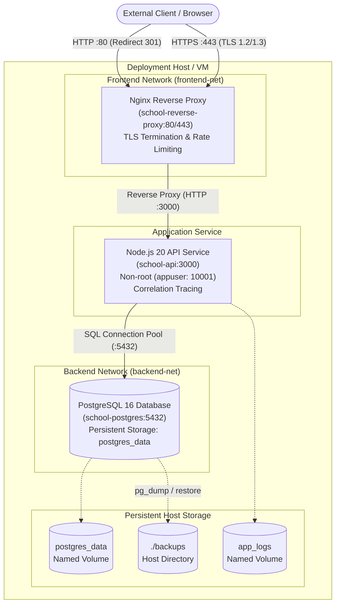
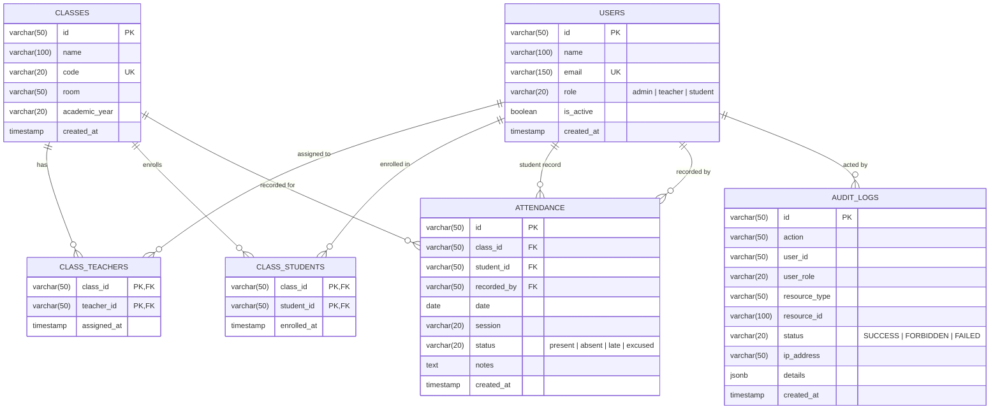
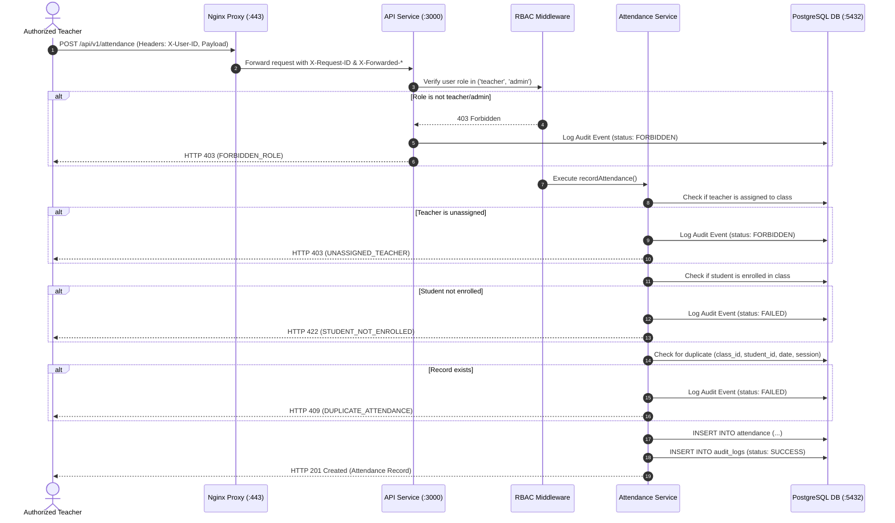

# System Architecture & Technical Design Specification
## School Management Platform – Cloud Deployment & CI/CD

---

## 1. High-Level Architecture Overview

The School Management Platform is architected as an observable, highly reliable microservice adhering to 12-factor cloud-native principles, least-privilege security, and defense-in-depth networking.

---

## 2. Component Design & Responsibilities

### 2.1 Ingress Reverse Proxy (`school-reverse-proxy`)
- **Technology**: Nginx 1.27 Alpine.
- **TLS Termination**: Offloads TLS processing using modern cipher suites (`TLSv1.2`, `TLSv1.3`).
- **HTTP to HTTPS Redirection**: Enforces encrypted transport across all application endpoints.
- **Rate Limiting**: Protects against denial-of-service with `limit_req_zone` (10 requests/second with burst allowance of 20).
- **Security Headers**: Injects HTTP defense-in-depth headers:
  - `Strict-Transport-Security: max-age=31536000; includeSubDomains; preload`
  - `X-Frame-Options: DENY`
  - `X-Content-Type-Options: nosniff`
  - `Content-Security-Policy: default-src 'self'`
  - `Referrer-Policy: strict-origin-when-cross-origin`

### 2.2 Application Service (`school-api`)
- **Runtime**: Node.js 20 LTS on Alpine Linux.
- **Execution Security**: Runs under an unprivileged non-root user (`appuser`, UID 10001, GID 10001).
- **Telemetry & Observability**:
  - `GET /health`: Liveness probe measuring event-loop responsive uptime.
  - `GET /ready`: Readiness probe verifying downstream PostgreSQL connectivity and pool status.
  - `GET /metrics`: Telemetry endpoint exposing latency stats, request counts, and memory usage.
- **Request Tracing**: Assigns or propagates a unique correlation ID (`X-Request-ID`) across every incoming HTTP request.
- **Graceful Shutdown**: Traps `SIGTERM` and `SIGINT` to drain existing connections, terminate HTTP listeners, and close database connection pools without packet drop.

### 2.3 Persistence Layer (`school-postgres`)
- **Engine**: PostgreSQL 16 Alpine.
- **Network Isolation**: Attached exclusively to `backend-net`; unreachable from the external host network or untrusted containers.
- **Data Persistence**: Uses a named Docker volume (`postgres_data`) surviving container rebuilds, restarts, or crashes.
- **Healthcheck**: Uses native `pg_isready -U school_admin -d school_management`.

---

## 3. Relational Data Model & ER Diagram

---

## 4. Attendance Write Request Flow & Security Enforcement

---

## 5. Security Architecture & Threat Model

| Threat / Risk | Mitigating Security Control |
| :--- | :--- |
| **Direct Database Probing** | PostgreSQL is attached exclusively to internal bridge network `backend-net`. No external ports published on host. |
| **Container Privilege Escalation** | Multi-stage Dockerfile drops root privileges; runs exclusively as unprivileged `appuser` (UID 10001). |
| **Eavesdropping / MITM** | Nginx terminates TLS 1.2/1.3 with modern cipher suites and enforces HSTS for browser trust. |
| **Denial of Service (DoS)** | Nginx rate limiting (10 req/s, burst 20); Express JSON body parser strictly capped at 1MB. |
| **Tampering / Unauthorized Access** | Strict RBAC; only assigned teachers can write attendance; full audit trail for all events. |
| **Vulnerable Dependencies / Base Image** | Automated `npm audit --audit-level=high` and Aqua Trivy container security scans in GitHub Actions CI. |
| **Secret Leakage** | All credentials injected via environment variables; `.gitignore` prevents committing secrets or `.env` files. |
